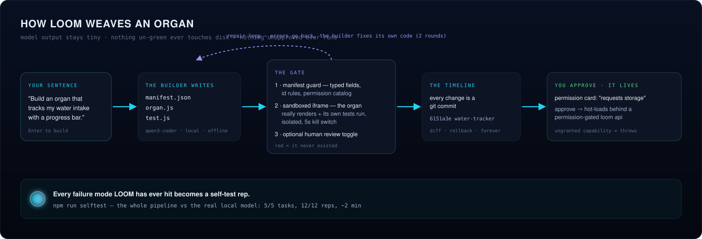
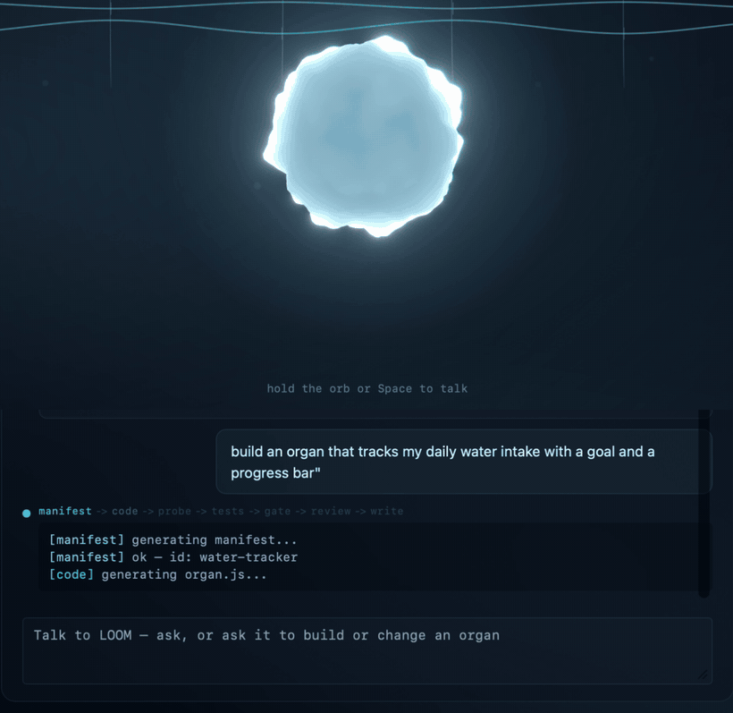
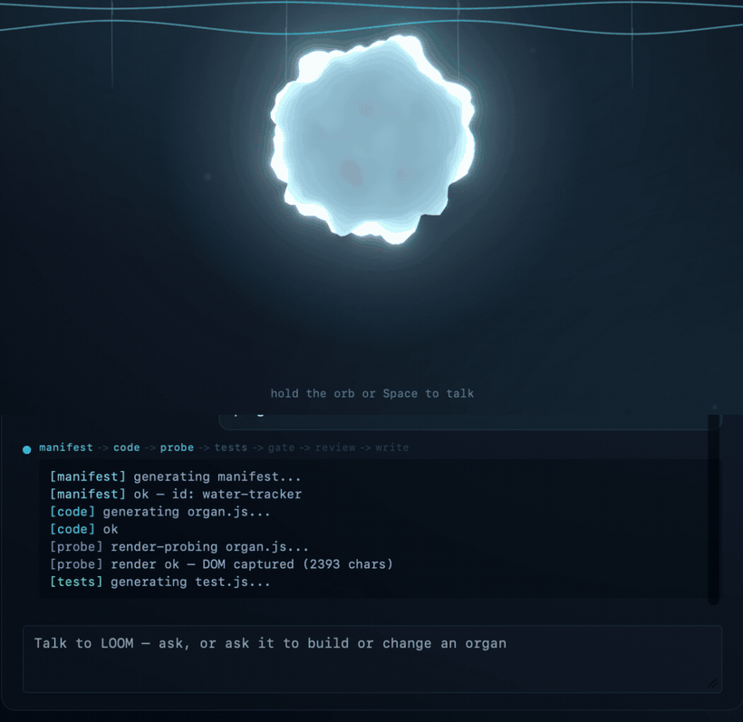

# LOOM

LOOM is a desktop app that builds its own tools. You describe a capability in one sentence. A local model plans it, writes the code and its tests, runs both through a validation gate, repairs its own failures, commits the result to a git timeline, and asks your permission before the new tool (an "organ") runs. Everything happens offline on your machine, with local models through Ollama.

**Approval is consent, not a sandbox.** Code is validated in isolation before you see it, but once you approve an organ it runs inside the app's own process (`src/lib/organs/host.tsx` loads it with a Blob URL and `import()`). There is no iframe or process boundary yet. Real organ isolation is on the roadmap, and until it lands the permission card is a decision you make, not a wall that contains the code.

It also needs a big machine: about 35 GB of models, sized to sit in memory on a 64 GB Mac. If you can't run it, the walkthrough below shows what it does.

LOOM grew out of the Forge inside [EMBER](https://github.com/AllStreets/ember), which showed that a small local model could maintain real software offline if a person reviewed every change. LOOM makes that loop the whole product.

## How an organ gets built



The model's output stays small: one file at a time, or one edit region. Three things stand between that output and your machine: the validation gate (a manifest check, a sandboxed render and the organ's own tests), the git timeline, and your approval. When a build fails, the errors go back to the builder. Tests are treated as the spec, so a failing "should not add an empty item" gets fixed in the code, not deleted from the tests.

<p>


</p>

*A real build from a screen recording. Left: manifest, code and a render probe pass. Right: the gate fails the organ's tests and the errors go back to the builder.*

The builder doesn't invent visual design. It composes from a small design kit (`loom.ui`) of cards, stats, progress bars, lists and buttons, so every organ looks like it belongs, and each one lives in its own window on the desktop.

An optional **Review code before saving** setting adds a fourth step: you read the files and choose Apply or Discard before anything is written.

## Powers and permission

An organ can only reach outside itself through powers it declares in its manifest: `timeline`, `voice`, `notify` and `pulse`. Before a new organ runs, the permission card says what it will be able to do, one plain-language line per grant with how much each one matters, then what will run: the organ's own file, which you can read in place, and the checks it already passed. It says that approval is consent, not a sandbox. The card is a real dialog (focus stays inside, Escape is Not now, and Not now has focus first, so a reflexive Enter grants nothing), and right after you approve there's an Undo. Each power has a budget, and you can revoke any of them from the organ's window while it runs. In the sandbox the powers are mocked deterministically, so the builder's tests check real behaviour.

LOOM can also propose an organ on its own, from a local usage observer and a rules engine that only fires on repeated evidence. The proposal is a card with three choices (weave it, not now, never), it's rate-limited, and it can be silenced.

## Editing itself

In dev mode, LOOM can edit its own TypeScript kernel and its own Rust core behind five checks:

1. validation in an isolated git worktree with real `tsc`, `vitest`, `cargo check` and `cargo test`
2. you approve the diff
3. the change is committed to source
4. a recovery boot rolls back an edit that breaks startup
5. a rule enforced in Rust stops it from editing its own safety code

The packaged app can rebuild itself offline. It carries its own git history. A one-time setup step ("threading", which needs the network once and says so) finds the build tools on the machine, vendors every crate and warms a build. After that, with the network unplugged, an approved core edit builds a new binary, keeps the running one as a previous generation, swaps the executable and relaunches. The previous generation watches the new one's first boot and restores itself if that boot never confirms.

### What has actually been run

On a clean clone with no prior build: threading cloned the history, vendored all 559 crates and built LOOM from source in 90 seconds. A re-run resumed in 0.03 seconds. A committed core edit built a new body offline in 18.5 seconds. The rebuilt app launched and drew its interface, and its watcher confirmed it in 2.6 seconds. A deliberately broken edit after that was rolled back in 1.8 seconds.

The first full run failed, and the failure taught me the most. Every part of the pipeline was correct, and the binary it produced had no interface inside it, because Tauri decides "this is a development build" from a flag its own CLI passes and a bare `cargo build` doesn't. One flag fixed it. An earlier review also found that the packaged app had never been built on that branch. Since then the rule is: build it and launch it before calling it shipped.

### Limits

- Organs run in the app's process once approved (see the top of this page).
- Setup needs the network once. The speech archive it downloads lands in a macOS cache LOOM doesn't own, and if the system clears it, offline rebuilding stops until the network is back.
- Re-signing a new build may make macOS ask for microphone permission again.
- A generation that boots and draws is confirmed even if it misbehaves later. Boot health is the check, and Settings can return you to an older generation.
- The LOOM home folder is several gigabytes, and Settings shows the size.
- Self-rebuild is macOS only for now.
- Not yet tested end to end: starting setup from LOOM's own interface rather than its functions, and relaunching through the system launcher rather than spawning the executable directly.

## The models

| Role | Model | Ollama tag | Size |
|---|---|---|---|
| Builder: writes LOOM's code | Qwen3-Coder-30B-A3B | `qwen3-coder:30b-a3b-q4_K_M` | 19 GB |
| Companion: the always-on assistant | gpt-oss-20b | `gpt-oss:20b` | 14 GB |
| Rewriter: restructures your request for the builder | Qwen3-1.7B | `qwen3:1.7b` | 1.4 GB |

All three stay loaded together. A slow or missing model times out, retries once, then falls back, so the interface never hangs. If the builder is missing, LOOM uses the best coder model you have installed.

Voice is optional and offline: Whisper for speech in and Piper for speech out, downloaded once from Settings. Hold the orb or Space to talk.

## Run it

You need macOS (Apple Silicon recommended), Node 20+, the [Rust toolchain](https://rustup.rs) and [Ollama](https://ollama.com), plus about 35 GB free for the models.

```bash
git clone https://github.com/AllStreets/loom.git
cd loom && npm install

ollama pull qwen3-coder:30b-a3b-q4_K_M
ollama pull gpt-oss:20b
ollama pull qwen3:1.7b

npm run check        # vitest and cargo test, should be fully green
npm run tauri dev
```

Then type something like *"Build an organ that tracks my daily water intake with a goal and a progress bar"* and press Enter. Watch it write, validate, repair and commit, then approve the permission card.

To package it, run `npm run tauri build`, open the app and say "thread the loom" (or Settings, LOOM, Thread the loom).

## How it was built

In phases, each one tested and reviewed before the next. Two of them were cuts. For a while LOOM grew a globe, a market terminal and an optional cloud builder. It was good work, but none of it was the point, since any wrapper can ship a dashboard. Phases 18 and 23a removed all of it, and the code stays in git history.

| Phase | What shipped |
|---|---|
| 1 to 6 | Tauri shell over a Rust core, the model fleet, the git timeline, the build loop with validation, repair and permission, the companion, the design kit and desktop, offline voice |
| 16 | The Tapestry (LOOM's history drawn live behind the orb) and the Shuttle (a ⌘K palette and voice sharing one command list) |
| 19 | Organ powers: declared, explained in plain language, budgeted, revocable, mocked in tests |
| 20 | Proposals LOOM makes on its own, with consent |
| 21 and 22 | Editing its own TypeScript kernel, then its own Rust core, behind the five checks |
| 18 and 23a | Removing the dashboard era |
| 23 | Rebuilding itself offline from its own history |
| Next | Real organ isolation, sandboxed validation outside the app process, Windows and Linux, Developer ID signing |

There are more than 1,300 tests (1,320 on the frontend alone). The design records (specs and plans, with the reasons for each decision) are in [`docs/design`](docs/design), and open follow-ups are in [`docs/FOLLOWUPS.md`](docs/FOLLOWUPS.md).

I built LOOM with coding agents. I set the direction and the constraints, and I review, test and decide what stays.

## License

Apache-2.0. See [LICENSE](LICENSE).
